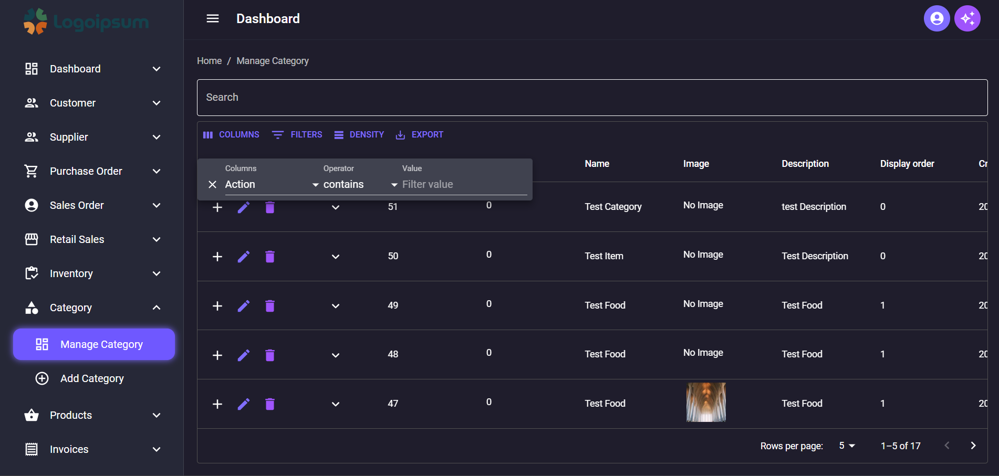

# Amazon Clone Project Using Django and React

Welcome to the Amazon Clone Project! This project is based on a tutorial series by the SuperCoders YouTube channel. The series walks through creating a fully functional Amazon clone using Django and React, complete with an inventory management system.

## Support 
- You love our open source project? We love you too! Your sponsorship helps us dedicate more time to development, improvements, and community support.

- Show your appreciation for our open source project. Your sponsorship directly impacts our ability to innovate and grow.

## Complete Project Flow 
screenshots/Ecommerce.gif

## Complete PO Flow (Purchase Order)


## Complete SO Flow (Sales Order)


## ER Diagram


-


## Project Overview

This project involves creating a clone of Amazon's web application. It includes features such as user authentication, product listings, a shopping cart, and an inventory management system. The project is built using the following technologies:

- **Backend**: Django (Python)
- **Frontend**: React (JavaScript)
- **Database**: MySQL

## Features

- User Authentication (Sign Up, Login, Logout)
- Product Listing and Search
- Product Detail View
- Shopping Cart Functionality
- Inventory Management System for Admin
- Order Management
- Purchase Order
- Sales order
- Supplier
- Warehouse Management
- User Management
- Multi Level Ecommerce Website
- Responsive Design

## Getting Started

### Prerequisites

Ensure you have the following installed on your local development machine:

- Python (>= 3.6)
- Node.js (>= 14.0)
- npm (>= 6.0)
- Django (>= 5.0)
- React (>= 17.0)
- MySQL Server

### Installation

1. **Clone the Repository**

### For Backend
```
-cd backend
python -m venv venv
source ../venv/bin/activate  # On Windows, use `venv\Scripts\activate`
pip install -r requirements.txt

DATABASES = {
    'default': {
        'ENGINE': 'django.db.backends.mysql',
        'NAME': 'your_database_name',
        'USER': 'your_database_user',
        'PASSWORD': 'your_database_password',
        'HOST': 'localhost',
        'PORT': '3306',
    }
}


python manage.py migrate
python manage.py runserver

```

### For Frontend

```
cd ../frontend
npm install
npm start
```

### Usage

Once both the backend and frontend servers are running, you can access the application at `http://localhost:3000` for the frontend and `http://localhost:8000` for the backend.

## Contributing

We welcome contributions! Please read our [contributing guidelines](CONTRIBUTING.md) for more information on how to get started.

## License

This project is licensed under the MIT License. See the [LICENSE](LICENSE) file for more details.

## Acknowledgements

- Special thanks to the SuperCoders YouTube channel for providing the tutorial series that made this project possible.

---

Enjoy building your Amazon clone! If you have any questions or run into issues, feel free to open an issue on this repository or reach out through the comments on the YouTube tutorial videos.


## Screenshots

### Empty Dashboard 


### DIfferent Themes

## Light Theme


## Blue Light Theme


## Blue Dark Theme


## Green Light Theme


## Green Dark Theme


## Red Light Theme


## Red Dark Theme


## Orange Light Theme


## Orange Dark Theme


### Dynamic Form For Add Product ScreenShot with JSON Key Value Pair Input and Multi Step form


## Sidebar Active Indicator


## Manage Category Page With Search,Sorting,Pagination,Item Per page,DataGrid,Expandable Child Item and API Integrated





## Added Multi File Upload with Preview in Dynamic Form 


## Added Manage Product Page


## Added Manage Product Review and Manage Product Questions and Preview Images


## Added Complete Warehouse and Rack Shelf and Floor Management


## Added Complete Manage Supplier/Admin/Customer/Staff


## Added Complete User Permissions and Assign Permission to User and Module Urls Manage


## Added Create Purchase Order


## Added Manage Purchase Order and Edit Draft PO Order


## Commits
# Commit Tree
